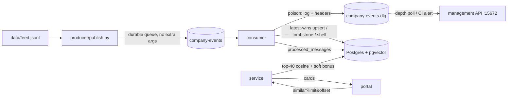
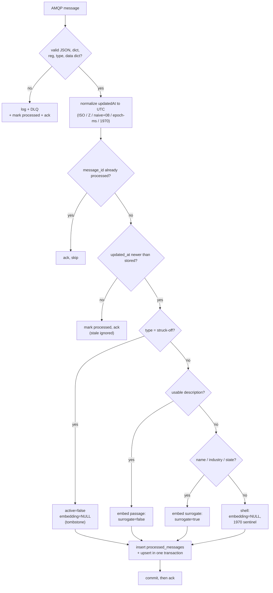
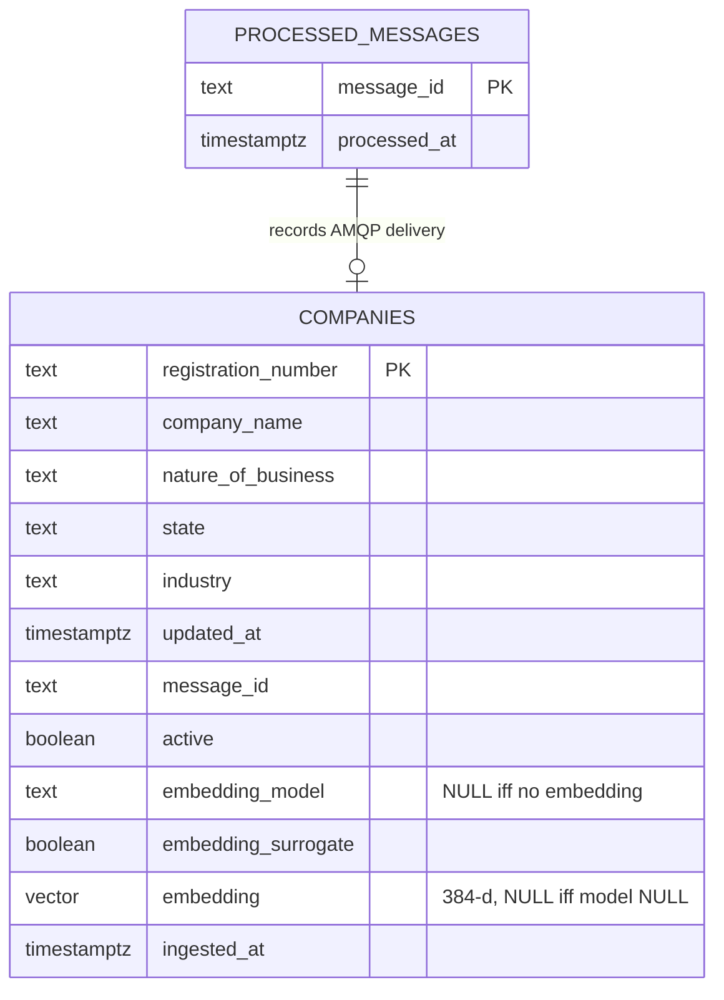

# DESIGN — Company Recommendation System

Status: design approved for implementation. Assessment `2026.11` (`mle-v2026.11`).
Time: owner controls stop; no fixed clock cutoff. Session start `2026-11-21T19:06:03+06:00` recorded for the log.
At stop, freeze work. Anything incomplete moves to "Future scope" below — no further edits.

## What exists (given scaffold)

| Piece | Detail |
|---|---|
| `docker-compose.yml` | `pgvector/pgvector:0.8.7-pg16` (DB `companies`, `postgres/postgres`, localhost:5432) + `rabbitmq:3.13.7-management` (5672, UI 15672), both healthchecked |
| `producer/publish.py` | replays `data/feed.jsonl` (2,518 lines) to durable `company-events`; `message_id = sha256(line)`; PERSISTENT; publisher confirms |
| `Justfile` | `setup`, `up`, `publish`, `down` |
| `pyproject.toml` | Python 3.14, only `aio-pika` |

## What gets built

```
company_rec/
  config.py     env-driven settings (DB, AMQP, queue, limit/offset caps, model, log level)
  events.py     raw line -> CompanyEvent | skip, with reason counters
  embed.py      fastembed wrapper, 384-d L2-normalised vectors + fallback
  db.py         asyncpg pool, idempotent DDL, latest-wins upsert, tombstone
  consumer.py   aio-pika consumer: parse -> embed -> persist -> ack
  service.py    FastAPI: GET /health, GET /companies/{reg}/similar
tests/
  test_events.py        parsing/normalisation of real anomalous feed lines
  test_db.py            latest-wins, idempotency, tombstone (integration)
  test_service.py       API shape, errors, ordering (integration)
README.md       own startup/run instructions
DESIGN.md       this file
```

New deps via `uv add`: `fastembed asyncpg fastapi uvicorn pydantic pytest pytest-asyncio`.
Justfile additions: `consumer`, `service`, `test` (integration tests skip cleanly when Docker is down).

## Visuals

### System flow



### Consumer decision path



### Service query path

```mermaid
sequenceDiagram
  participant W as Portal
  participant S as Service
  participant E as Embedder
  participant D as Postgres / pgvector
  W->>S: GET /companies/{reg}/similar?limit=4&offset=0
  S->>D: fetch query company (404 if unknown/struck-off)
  S->>E: embed "query: " + description
  E-->>S: query vector
  S->>D: ORDER BY embedding <=> $q, registration_number LIMIT 40
  D-->>S: 40 candidates + cosine scores
  S->>S: soft industry/state bonus; stable sort by score, reg
  S->>S: slice offset : offset+limit
  S-->>W: results + has_more
```

### Schema



## Feed reality — measured, not assumed

2,518 lines → 2,507 dict events, 5 malformed JSON (literal newline inside `companyName`), 6 `null` lines.
Event types: 2,499 `company-upserted`, 8 `company-struck-off` (no `data`).
2,052 distinct registration numbers; 363 appear more than once (max 7 events). Feed is **not** ordered by time:
`SYN-000155` has a 22:03 event before a 15:39 event. `updatedAt` is 2,470 ISO strings, 30 int epoch-ms, 7 missing.
7 events lack `registrationNumber`; 17 have empty `data`; 14 have only `companyName`; 9 have non-dict `data`.
Nulls: industry 151, state 91, natureOfBusiness 60. Extra keys `source` (38), `ingestedBy` (37).
State casing varies (`selangor`, `SELANGOR`, `KUALA LUMPUR`).
Descriptions: ~1,576 English, ~666 Malay, ~190 mixed. This drives the model choice.

## Decisions

**D1 — Consumer delivery semantics + app-level DLQ.** `company-events` declared durable, no extra args
(registry owns it); re-declaring with `x-dead-letter-exchange` → `PRECONDITION_FAILED`, so broker-level DLX is
unavailable. `aio-pika` robust connection, manual `ack`. Poison (malformed JSON, `null`, missing registration
number, unknown type, **upsert with non-dict `data`** — see D6; 9 such events) → log with line number and reason,
publish to an app-level DLQ we own
(`company-events.dlx` direct → `company-events.dlq`) with headers `message_id`, reason, line no, timestamp,
then `ack` source. No requeue loop (`nack(requeue=True)` would redeliver forever and stall valid messages).
DLQ dedup reuses `processed_messages` from D3 — a poison message already recorded is not republished, so a
crash between DLQ publish and source ack cannot create duplicate DLQ entries. Depth check: poll RabbitMQ
management API (`GET /api/queues/%2f/company-events.dlq`, port 15672) and alert when depth exceeds the fixed
baseline of **22** or grows between checks; also visible in the management UI. Baseline 22 = 5 malformed JSON
+ 7 missing registration number + 6 `null` lines collapsed to 1 by shared `message_id` (`sha256("null")`)
+ 9 upserts with non-dict `data`, all with distinct IDs — 22 distinct poison IDs from the seed feed. Fixed,
not DB-derived — simpler; recompute only if the feed or `message_id` derivation changes. Valid messages are acked only after DB commit, so at-least-once delivery is
preserved. Counts logged at shutdown for the DESIGN data-quality note.

**D2 — Latest-wins identity.** Natural key = `registrationNumber`. Feed is not time-ordered (`SYN-000155`
has a 22:03 event before a 15:39 one), so last-arrival-wins would regress a company. Source-side `updatedAt`
is the truth; normalize to aware UTC from all four observed shapes:
- ISO with `+08:00` (2,428) → `datetime.fromisoformat`, already aware.
- ISO with `Z` (28) → `fromisoformat` handles `Z` on Python 3.14.
- ISO with no offset (14) → **assume Malaysia local `+08:00`**; attach that tz. Without attachment the value
  is naive and comparison with aware UTC raises `TypeError`. Assumption: these match surrounding local times
  (`09:06:19` local = `01:06:19Z`).
- int epoch-ms (30) → `datetime.fromtimestamp(v / 1000, tz=timezone.utc)`; 13 digits, range confirmed against
  the ISO values.
- missing (7) → sentinel `1970-01-01T00:00:00+00:00`, so any dated event wins. Do **not** use ingest time:
  a late stale event would then look newest. Tradeoff: a genuinely-new event with no timestamp is ignored.

Upsert:
`ON CONFLICT (registration_number) DO UPDATE ... WHERE excluded.updated_at > companies.updated_at`
`OR (excluded.updated_at = companies.updated_at AND excluded.message_id > companies.message_id)`.
`message_id` is `sha256` of the raw line — fixed-length lowercase hex, so lexicographic string compare is a
deterministic total order. Arbitrary, not temporal; it makes replay converge to the same row regardless of
delivery order. Out-of-order duplicates therefore cannot regress a company.

Assumption: more timestamp-less `Unknown`-style events may appear at scale; all stay low-priority under the
sentinel. Format-change alert (noted, not implemented): count missing-`updatedAt` events per run and alert if
the ratio rises above this feed's ~0.28% (7/2,507), or if a timestamp-less event carries a real
`natureOfBusiness`. Guards against a source silently dropping `updatedAt` on genuine updates, which the
sentinel would otherwise ignore without any visible failure. Arrival time is deliberately not used as a
fallback — at-least-once out-of-order delivery would let a late stale event win.

**D3 — Idempotency.** Table `processed_messages(message_id TEXT PRIMARY KEY, processed_at TIMESTAMPTZ)`.
On each message, insert ID then handle: on conflict skip. Covers at-least-once redelivery of the same line.
Valid message: insert + D2 upsert in one DB transaction; commit before ack. A message whose D2 `WHERE`
rejects it (stale) is still marked processed — "handled" includes deliberately ignored — so redelivery does
not re-evaluate it. Poison (D1): insert ID, publish to DLQ, then ack — insert **before** publish, so a crash
after publish cannot duplicate the DLQ entry; crash between insert and publish loses that DLQ entry (log
retains it). Cross-system exactly-once needs an outbox; this ordering picks no-duplicates over no-losses.
Different lines for the same registration number, and lines that fail D2's guard, are all marked processed;
D2 decides which one wins the row. Replays add zero rows — same lines, same hashes, dedup catches them.
Current feed: 2,518 lines → 2,450 distinct IDs. 10x volume ≈ 24,500 rows (~5 MB) — no retention needed;
far-future only, and only if `message_id` derivation changes.

**D4 — Tombstones.** `company-struck-off` sets `active=false`, `embedding=NULL` (row kept for audit; clearing
the vector removes it from the HNSW graph, so index size tracks live companies — simpler than a partial index
and no planner predicate trap). Re-embed on later re-registration. Strike writes a tombstone row even if the
company was never seen: `updated_at` from the strike, `embedding NULL`, placeholder `company_name` (D7 requires
NOT NULL). Otherwise a strike-before-upsert order lets a late older upsert resurrect the company — D2's guard
then blocks it. Both strikes and upserts obey D2: a strike older than the stored upsert is ignored; a later
upsert sets `active=true` (re-registration). Search filters `active=true AND embedding IS NOT NULL`; direct
query for a struck-off company returns 404. Feed check: all 8 strikes have a prior upsert and none have a
later one, but design covers the out-of-order case.

**D5 — Embedding model.** `fastembed` + `intfloat/multilingual-e5-small` (384-d, ONNX, CPU).
Reason: ~30% of descriptions are Malay; README's `BAAI/bge-small-en-v1.5` and the locally cached
`Snowflake/snowflake-arctic-embed-xs` (91 MB, already in HF cache) are English-only. All three are 384-d,
so the pgvector schema is model-agnostic; only the `embedding_model` column records which produced a row.
`hf` CLI is authenticated (`siren77`) with `hf_xet 1.8.0` enabled, so a prefetch is fast if fastembed's own
fetch is slow. Prefix convention: `"passage: "` for stored descriptions, `"query: "` for the query company.
Fallback if the download fails: cached arctic-embed-xs, with the Malay-quality caveat written up.

Chunking: none. 2,432 descriptions, p50 6 words, p99 9 words; only 7 exceed 150 chars and those are the same
phrase repeated, so truncation at the model's 512-token limit loses no information. One vector per company.
Alternatives considered: e5-base / bge-m3 improve multilingual recall but need 768/1024-d schema migration
and full re-embed; English models regress on Malay. Decision: keep e5-small for v1. Optional deep dive after
the main build — cross-encoder reranker (e.g. `bge-reranker-v2-m3`) on top-20 candidates for precision, no
schema change; implement only if time allows. Quality evaluation of Malay recall is the trigger to reconsider
the base model.

**D6 — Missing description.** "Usable description" = `natureOfBusiness` is a string with non-empty `strip()`.
If absent, still store the company ("no lost companies") and embed surrogate `"{industry} {companyName} {state}"`
from whatever fields are present, flag `embedding_surrogate=true`. Such rows are recommendable but lower
quality; excluded from the quality-eval set. Assumption: an upsert with non-dict `data` (`null` or a string,
9 events in the feed) is a malformed update, not a legitimate field wipe — treated as poison (D1), logged +
DLQ'd, and **not** applied to an existing row. DLQ baseline rises from 13 to 22 distinct IDs.
For a first-ever malformed upsert, write a **shell row**: reg, placeholder `company_name`, `active=true`,
`embedding NULL`, `updated_at` = 1970 sentinel, `message_id` processed. Sentinel (not the event's timestamp)
lets any later dated valid event win under D2; otherwise a valid event older than the malformed one would be
blocked forever. No overlap in this feed between the 9 malformed-data events and the 7 timestamp-less events,
so shell-vs-untimestamped tie is theoretical — no `incomplete` flag needed.
If all surrogate fields are empty, leave `embedding NULL` (do not embed `""` or a bare reg) — row stays
queryable for cards, excluded from recommendations by D8's `embedding IS NOT NULL` filter. After D2 latest-wins:
46 companies lack a usable description → 39 surrogate vectors + 7 shells (the shell cases previously showed
as empty surrogates).

**D7 — Schema.**

```sql
CREATE EXTENSION IF NOT EXISTS vector;
CREATE TABLE companies (
  registration_number TEXT PRIMARY KEY,
  company_name TEXT NOT NULL,
  nature_of_business TEXT,
  state TEXT, industry TEXT,
  updated_at TIMESTAMPTZ NOT NULL,
  message_id TEXT NOT NULL,
  active BOOLEAN NOT NULL DEFAULT TRUE,
  embedding_model TEXT,                 -- NULL iff no embedding (shells, struck-off)
  embedding_surrogate BOOLEAN NOT NULL DEFAULT FALSE,
  embedding vector(384),
  ingested_at TIMESTAMPTZ NOT NULL DEFAULT now()
);
CREATE INDEX companies_embedding_hnsw
  ON companies USING hnsw (embedding vector_cosine_ops);
```

`embedding_model` nullable: NULL iff `embedding` NULL — no sentinel string. Set both together on embed, both
NULL on shell/strike. Enforce the invariant in code, not schema; re-embed query uses
`WHERE embedding_model IS DISTINCT FROM $current`. No `companies_active_idx`: pgvector 0.8.7 does not index
NULL vectors, so shells/struck-off rows are already outside the HNSW graph; a B-tree on a near-constant boolean
adds nothing and the planner would ignore it. `active = true` stays in D8's query for correctness. No partial
index needed. Iterative scans (`hnsw.iterative_scan`) unnecessary at 0.4% inactive — scale note only.

**D8 — Service API.**

`GET /health` → `{"status":"ok","db":"ok"|"down"}`.
`GET /companies/{reg}/similar?limit=4&offset=0` →
`{"registrationNumber", "companyName", "has_more": bool,
"results":[{"registrationNumber","companyName","natureOfBusiness","state","industry","score"}]}`.
`limit` 1–20 (default 4), `offset >= 0`, `limit + offset <= 40`, else 422. Client pages within the single
top-40 candidate window; no extra DB query per page. Total order: adjusted score desc, then
`registration_number` asc at both SQL (`ORDER BY embedding <=> $q, registration_number LIMIT 40`) and app
sort, so equal-score rows cannot move between pages. No cursor or snapshot — concurrent writes can shift
results between requests; acceptable for a 4-card panel.
Score = `1 - (embedding <=> $q)` (cosine similarity). Query `ORDER BY embedding <=> $q ASC LIMIT 40` so
HNSW is used; compute the friendly score in the SELECT projection only, never in `ORDER BY` (planner would
drop the index). Query excludes self and inactive rows, filters `embedding IS NOT NULL`; `limit=4` matches the portal mock.

Ranking: soft industry/state preference, not a hard filter. From the top 40 candidates, add a small bonus
(+0.01–0.03 cosine score, or tie-break only when within 0.02) for matching normalized `industry` (and
optionally `state`), then take `limit` rows from `offset`. Hard filter rejected: 359 industry+state cells, median size 3, 199 cells
have <4 companies; 110 null-industry / 57 null-state rows; state has 47 raw casing variants. README mock is
cross-state and includes a Logistics neighbour for a Food & Beverage query — hard filtering would break it.
HNSW default `hnsw.ef_search = 40` already bounds the candidate list, so `LIMIT 40` adds no extra loss; a
small bonus cannot promote a distant 41st+ candidate into top 4. Revisit with `ef_search = 100` / exact scan
only if evaluation shows recall loss — not needed at ~2k rows. Score is internal ranking, not exposed as a
percentage; not calibrated across models.

Errors: 404 unknown/struck-off reg, 422 bad params (FastAPI default), 503 DB unavailable — uniform
`{"detail": ...}` JSON. No caching in v1; HNSW over ~2k rows is well under page-load budget.

**D9 — Packaging.** `uv sync --locked`, then `just up`, `just publish`, `just consumer`, `just service`.
Consumer and service are separate processes so either can restart independently.

## 10x volume

- Consumer: prefetch N + batch embed + bulk upsert; run multiple consumers (RabbitMQ competitive consumers);
  partition by `registration_number` hash if a single writer saturates; DLQ exchange for poison.
- DB: HNSW already logarithmic; tune `m`/`ef_construction` and per-query `hnsw.ef_search`; `halfvec(384)`
  halves index memory; read replica for the service; PgBouncer for pool limits; add an `embedding_model`
  filter when models are swapped.
- Service: cache top-k per registration number in Redis with TTL + invalidate on upsert; serve from replica;
  track p95 and recall@4 against a labelled sample.

## Future scope (pulled forward if time runs out)

- Quality deep dive: hand-label a stratified sample (industry × language), report recall@4 for
  multilingual-e5 vs the English baselines; measure Malay/English cross-lingual pairs.
- Monitoring deep dive: consumer lag, drop counters, embedding latency, DB pool saturation, query p95,
  score-distribution drift.
- LLM explanation design only (no paid API): local instruct model, retrieved neighbour as context, template
  prompt, no live endpoint.
- Cross-language normalisation of `natureOfBusiness`, industry-aware reranking, caching (in-process TTL or
  Redis — only if evaluation shows it pays; not in v1). DLQ and API pagination are now in scope (D1, D8), not future work.

## Repository / delivery notes

- Commit directly to `main`. No branches, no PRs.
- `README.md`: keep the supplied scenario/stack/setup content; add a "Running this solution" section with exact
  commands, env vars, dependency versions, model name and seed. Add a pointer to the exported session file.
- Session export lives at `sessions/ses_e01c94005ffeTwoFwQ0BDLPNdD.json` (generated with
  `opencode session export ses_e01c94005ffeTwoFwQ0BDLPNdD`); commit it with the solution.
- `sessions/` also holds learning material (`sessions.md`): the Claude-generated HTML walkthrough and a
  Google AI Mode reference link, both for learning only.

## Tooling / AI disclosure

- OpenCode session `ses_e01c94005ffeTwoFwQ0BDLPNdD`, model `opencode/hy4-flash-free`, used for assessment,
  design and implementation. Export: `opencode session export ses_e01c94005ffeTwoFwQ0BDLPNdD`.
- `ccc` (CocoIndex Code) skill used to index the scaffold; `hf` CLI (authenticated) inspected model options.
- Session context (not for README): we normally use sub-agents/workers with an orchestrator, but not here —
  job is small enough and OpenCode isn't the harness for that setup. This model is in use because the personal
  Codex plan was exhausted after three resets this week on another hackathon; may switch model when the
  OpenCode free limit runs out. Not a solution decision.
- All reasoning in this file can be walked through line by line.
